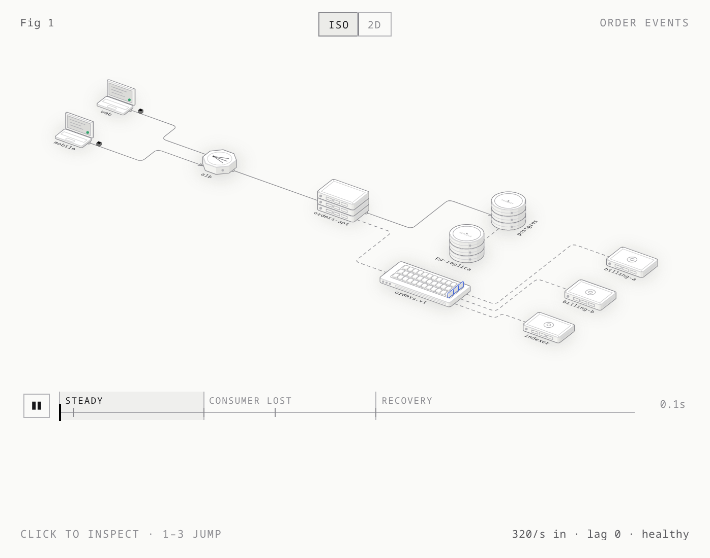

# Topology

**An agent skill that turns a distributed system into an interactive, simulated diagram.**

Works with Codex, Claude Code, and OpenCode. Ships standalone HTML and static SVG; no npm dependencies or agent-specific APIs.

Write a spec of nodes, links, zones, rates and a short story. The build lays it out, routes the links, and draws it two ways: **isometric** (servers, disks, brokers and gateways standing on a floor) and **flat 2D** (the same layout as glyphs, reached by a camera morph). A seeded simulation moves requests through it with model-derived throughput, p50/p99 latency, and failure readouts:

- queues fill and answer 503
- timeouts trigger retries, and breakers trip
- Kafka partitions fill, cursors chase them, and leaders get re-elected
- DNS keeps sending to a dead region until its TTL expires
- canaries ramp, and a kill switch sends traffic back

The story plays on its own with a timeline and narration. Click a node to inspect routes or tables, follow a request, and use Fail/Restore or F to take over; the readout always says what the model says.



[Watch or download the MP4](docs/media/order-events.mp4) · [Demo spec](examples/order-events/order-events.spec.mjs)

Recorded from the working example at 2× model speed. The same system switches from isometric to 2D after recovery begins. Rates and failures are illustrative.

## Install the skill

```sh
npx skills add cbxss/topology
```

Choose your agent in the installer, or target one explicitly:

```sh
npx skills add cbxss/topology --skill topology --agent codex
```

Add `--global` to make it available across projects. This installs directly from
GitHub and works independently of the npm release. The [skills CLI](https://github.com/vercel-labs/skills#readme)
discovers the root `SKILL.md` and installs its supporting files with it.

## Quick start

```sh
node scripts/serve.mjs examples                                             # dev server with live reload: http://127.0.0.1:8765/
node scripts/build.mjs examples/order-events/order-events.spec.mjs          # → order-events.html
node scripts/build.mjs examples/order-events/order-events.spec.mjs --light
node scripts/build.mjs examples/order-events/order-events.spec.mjs --check  # run the model and the story headless
node --test tests/*.test.mjs                                                # the model's tests
```

No dependencies: Node 20.10+ for building. Browser checks require Node 22+ (built-in WebSocket) and Chrome or Chromium.

Use the whole repository as the skill folder: [SKILL.md](SKILL.md) is the entry point, and the kit, scripts, references, and examples must stay alongside it. For Claude Code, copy or symlink the folder to `~/.claude/skills/topology`, then ask for an architecture figure:

```text
/topology show our checkout path: CloudFront → ALB → 3 api pods → Redis (85% hit) → Aurora with a reader, and the outbox to Kafka
```

<details>
<summary><b>More prompts</b>, from the skill's <a href="evals/evals.json">evals</a></summary>

- "I'm writing a blog post about why our Kafka consumers fall behind. Checkout publishes to a 6-partition topic at ~1,200 msgs/s; fulfillment has 3 consumers at ~450/s each, analytics 1 at ~1,500/s. Show what happens to fulfillment's lag when one consumer dies."
- "can you make a diagram of our checkout request path for the design review? browser → cloudfront → ALB → checkout-api (3 pods) → redis (~85% hit), on a miss aurora with one reader, plus stripe (~300 ms). make it something people can poke at"
- "Make a figure for our incident write-up showing how retries turned a slow inventory service into a full outage, and how adding a circuit breaker fixed it." (with the timeout, retries, capacity and slowdown)
- "We run active-active in two regions behind Route 53 (TTL 60s)… I need a 2D diagram for the runbook that shows what a regional failover looks like."
- "Show how we roll out a new checkout behind a feature flag: 5% → 25% → 50%, v2 starting to throw errors at 50%, and us hitting the kill switch."
- "Here's our docker-compose… turn this into one of those animated system figures. I don't have real traffic numbers."
- "just need a static svg of a simple 3-tier app for a slide"
- "My team doesn't get why losing ONE Kafka broker is fine but losing TWO stops all writes (RF 3, min ISR 2, acks=all). Can you make something that shows it?"

Each comes with what a good answer contains, for running with the skill-creator.
</details>

## A spec

```js
export default {
  title: "Order events",
  sim: { per: 40 },
  nodes: [
    { id: "web", kind: "client", emit: 6 },
    { id: "alb", kind: "lb" },
    { id: "orders", kind: "service", replicas: 3, label: "orders-api" },
    { id: "pg", kind: "db", role: "primary" },
    { id: "topic", kind: "kafka", partitions: 3, label: "orders.v1" },
    { id: "billing", kind: "worker", rate: 12 },
  ],
  edges: [
    ["web", "alb"], ["alb", "orders"], ["orders", "pg"], ["orders", "topic"],
    { from: "topic", to: "billing", group: "billing" },
  ],
};
```

Kinds: `client`, `lb`, `gateway`, `service`, `worker`, `cache`, `redis`, `elasticache`, `db`, `dynamodb`, `storage`, `kafka`, `queue`, `cdn`, `dns`, `external`, `scheduler`, `flags`, `box`.

Behaviour:
- sources, emit curves and schedulers
- routing: `all` with per-edge probability, `roundrobin` with health-check delay, `random`
- awaited sync calls, endpoint route mixes, and request/span following
- synthetic records, full saved-field inspection, and following writes across primary/replica copies
- table operations, row locks, stale reads, lost updates, and ordered WAL replication
- `capacity` + `queue`, timeouts, retries with backoff, circuit breakers
- Kafka partitions, consumer groups, brokers, RF, min ISR, acks, hot partitions
- competing-consumer queues, replication, CDN hit ratios, DNS TTLs
- feature flags with rollouts and kill switches
- scenarios with named phases

Common shapes come as patterns you compose: `region()`, `kafkaTopic()`, `cacheAside()`, `replicatedDb()`, `queueWorkers()`, `canary()`. Browse every kind and pattern, drawn in iso and 2D with the spec that makes it, in the [component catalog](examples/catalog/catalog.html) (`node scripts/catalog.mjs`).

Tool features (the morph, trails, labels, hops and the rest) can be toggled per spec, per build or per URL. Every field is in [`references/spec.md`](references/spec.md).

## Layout

```
SKILL.md                 the skill: when to use it, the workflow, the visual language
references/spec.md       every spec field and exactly what the simulation does
references/craft.md      vocabulary, colour, layout patterns, sizing numbers, adding a kind
references/verify.md     --check, capture, drive, line ends, the review checklist
kit/topo.mjs             layout, routing, iso and flat renderers, label placement, CSS
kit/topo-sim.mjs         stable simulation entry point (implementation in kit/sim/)
kit/topo-live.js         the page runtime
kit/iso.mjs              the drawing core: camera, shaded solids, lines on faces, SVG, the card
scripts/build.mjs        spec → standalone HTML (and --check, --svg)
scripts/capture.mjs …    headless Chrome screenshots, scripted sessions, line-end check (browser.mjs)
kit/topo-story.js        the scenario player; kit/topo-edit.js the drag editor; kit/topo-features.mjs toggles
scripts/serve.mjs        dev server: rebuild per request, SSE reload, ?edit
kit/patterns.mjs         reusable fragments: region, kafkaTopic, cacheAside, replicatedDb, queueWorkers, canary
scripts/catalog.mjs      the component catalog page
examples/                12 runnable system/data stories, plus the component catalog
docs/media/              README GIF and MP4, recorded from the actual example
scripts/record-demo.mjs  regenerates the README media (Chrome + ffmpeg)
tests/                   node --test tests/*.test.mjs
evals/evals.json         test prompts and what a good answer contains
agents/openai.yaml       display name and short description for Codex
.github/workflows/ci.yml Node tests, browser parity/controls, model checks, reproducible page builds
```

## Endpoint and data stories

- [Reusable data stores](examples/data-stores/data-stores.spec.mjs): Redis, ElastiCache and DynamoDB components with saved-field inspection.
- [Orders API](examples/orders-api/orders-api.spec.mjs): route mixes, synthetic records and table inspection.
- [Read your writes](examples/read-your-writes/read-your-writes.spec.mjs): replica lag and stale reads.
- [Idempotent retries](examples/idempotent-retries/idempotent-retries.spec.mjs): committed writes, timeouts, conflicts and upserts.
- [Lost updates](examples/lost-update/lost-update.spec.mjs): hot-key races and row locks.

The overview stays compact; click for details, choose a route to filter traffic, then follow a request for its span timeline. These examples model illustrative workloads, not a SQL database or exactly-once side effects.

To author a figure, start with [the spec reference and runnable recipe](references/spec.md#minimal-endpointtable-recipe), choose an example from [the skill](SKILL.md), and run the [verification workflow](references/verify.md). The kit supplies the engine; a new supported story needs only a spec. [Engine maintenance](references/engine.md) documents module ownership and browser packaging.

## What the model covers

This is an explanatory simulation. Its figures report results from the configured
model; they are not production benchmarks or vendor performance predictions.

- **gRPC:** represent unary request/response flows with synchronous edges and labels, timeouts, retries, and breakers. HTTP/2 streaming and Protobuf are not simulated.
- **Kafka:** producers, partitions, consumer groups, lag, rebalancing, broker failures, elections, and ISR. Offsets advance on dispatch; durable acknowledgements and crash redelivery are not modeled.
- **Redis / ElastiCache:** distinct reusable components backed by the cache model. Cache misses are probabilistic; commands, TTL, eviction, and managed-service failover are not modeled.
- **DynamoDB / databases:** simulated rows, saved fields, operations, versions, and direct replication. The record inspector's `SELECT *` is a read-only illustration, not a SQL parser. Vendor consistency guarantees, disk durability, and exactly-once side effects are outside the model.

See the [spec reference](references/spec.md#validation-and-recovery-limits) for the precise boundaries. Figure captions should disclose synthetic data, assumed rates, and relevant simplifications.

## Verify and export

```sh
node --test tests/*.test.mjs
node scripts/verify-sim-browser.mjs  # Node 22+ and Chrome/Chromium
node scripts/build.mjs examples/orders-api/orders-api.spec.mjs --check
node scripts/build.mjs examples/orders-api/orders-api.spec.mjs --svg --light
```

The last command emits standalone HTML plus separate isometric and flat SVGs next
to the spec. Open generated HTML directly, or use the local server's example index.
The repository's HTML links show source on GitHub; run the server to interact with them.

CI tests the model and generated pages, checks every example, and rebuilds both
themes and the catalog without changes to committed artifacts. For screenshots,
interaction checks, and line-end checks, follow [verification](references/verify.md).

To regenerate the demo (also requires `ffmpeg`):

```sh
node scripts/build.mjs examples/order-events/order-events.spec.mjs --light
node scripts/record-demo.mjs
```

## npm releases

The package name is `@cbxss/topology`. It distributes the complete skill, kit,
references, scripts, runnable examples, and verification files. README recordings
and local working files are excluded from the npm archive.

After the first publish, install it with `npm install @cbxss/topology`. The skill
folder is `node_modules/@cbxss/topology`; keep its contents together when copying
or linking it into your agent's skills directory. You can also build directly:

```sh
node node_modules/@cbxss/topology/scripts/build.mjs my.spec.mjs
```

Maintainers: the **Publish to npm** workflow runs the full CI suite and verifies
builds from an isolated npm archive before publishing publicly with provenance.
It reads the repository secret `NPM_PUBLISH` only in the publishing step.

- For the initial `1.0.0` npm release, run **Publish to npm → Run workflow** on
  `main`. The existing `v1.0.0` Git tag predates the npm manifest.
- For subsequent releases, update `package.json` and the version in `SKILL.md`,
  commit, and push a matching `vX.Y.Z` tag. A mismatched tag fails publication.
- Manual runs on `main` are also supported. Each npm version can be published
  once; rerunning an already published version will fail instead of replacing it.

Run `npm run verify:package` to check the archive locally. Token authentication
and provenance follow [npm's publishing guidance](https://docs.npmjs.com/generating-provenance-statements/).

## License

MIT. See [LICENSE](LICENSE).
